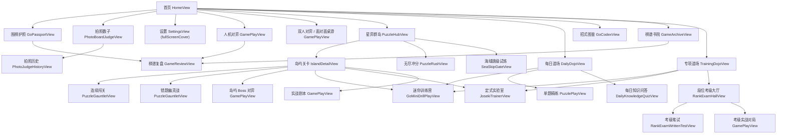

# StarYi Go（星弈围棋）产品需求与交互规范文档（PRD）

> **文档版本**：v2.0（基于 `main` @ `7302262` 反推与近期迭代梳理）  
> **适用平台**：**专注 iPadOS 18.0+（全面适配 iPadOS 26/27 自由窗口，最小窗口锁定 1024×700 横屏体验）**（`TARGETED_DEVICE_FAMILY = 2`，不支持 iPhone）  
> **外观策略**：**锁定浅色模式（Light Mode）**——面向儿童护眼与白天练棋场景，引导健康作息；色彩体系统一收敛于 `AppTheme`，为未来版本按需拓展深色模式预留结构  
> **支持语言**：简体中文（`zh-Hans`）、繁體中文（`zh-Hant`）、English（`en`）、日本語（`ja`）、한국어（`ko`）  
> **核心定位**：离线优先、儿童友好、专业级 AI 驱动的一站式围棋启蒙、闯关、对弈、拍照数子与棋道文化学习应用

---

## 1. 产品定位与核心价值

### 1.1 目标用户与场景
1. **儿童与青少年围棋初学者（5–14 岁，30K–10K）**：通过游戏化 5 海域闯关、拟人化吉祥物陪练、视觉辅助阶梯（气数提示/打吃警报/表情棋子）与每日道场养成持续练棋习惯。
2. **进阶棋手与成人爱好者（10K–5D+）**：通过离线 KataGo CoreML 引擎对弈、全盘复盘胜率曲线、定式与破骗招训练、段位考级与线下实体棋盘拍照数子提升棋力。
3. **家庭与亲子场景（客厅双人/多孩家庭）**：支持同一设备多儿童独立档案、客厅面对面双人对弈（含段位平衡自动让子）、零广告、零联网依赖、家长门护航与护眼定时提醒。

### 1.2 核心设计原则
- **100% 离线可用**：AI 对弈（3 档内置 KataGo 模型）、拍照数子（Vision + CoreImage + KataGo 领地评估）、题库、语音与棋谱书院全部本地运行，无账号登录与隐私追踪（`NSPrivacyTracking = false`）。
- **视觉辅助渐进脱敏（Graduation Ladder）**：提供"启蒙（Starter）→ 进阶（Intermediate）→ 考级仿真（Exam Sim）"三档一键辅助预设，帮助孩子逐步脱离气数/打吃提示过渡到真实对弈。
- **明快党派化美学（Bright Party Craft）**：高饱和度天蓝/薄荷/暖阳/珊瑚色系、立体光泽胶囊按钮、榧木棋盘与蛤碁石纹理、物理阻尼弹簧动效与多语种童声正向激励。

---

## 2. 信息架构与导航流图

应用采用单一 `NavigationStack`（`RootNavigationView`）+ 全局设置 `fullScreenCover` + 全局招式图鉴解锁顶部 Toast + 护眼弹窗。

---

## 3. 核心模块功能与交互规范

### 3.1 首页（`HomeView`）
- **视觉氛围**：全屏 `HomeBackdrop` 背景 + 漂浮星光粒子 + 居中悬浮多语言 Logo（支持点击弹跳反馈）。
- **顶部功能栏**：
  - **左侧**：用户护照入口胶囊（吉祥物头像、昵称、认证段位、`Lv.X` → 跳转 `GoPassportView`）。
  - **右侧**：进度状态胶囊（星星数、金币、连胜火焰、每日道场 `done/3` 进度环；点击弹出引导 Popover，可直达群岛/设置/每日道场）、拍照数子入口、BGM 开关、音效开关、设置齿轮。
- **双核心主入口（Hero Portals）**：
  1. **人机对弈（Play vs AI）**：主按钮一键开局；下方 4 枚快捷菜单胶囊分别选择：棋盘路数（5/7/9/13/19）、10 阶 AI 对手、规则/执色/让子（标准对局或吃子棋 1/3/5 颗、执黑/白、让 2–9 子）、棋钟/读秒与 AI 陪练教学风格（标准/吃子练习/棋形连接/征子枷吃）。
  2. **星弈群岛（StarYi Islands）**：展示海域/关卡/已通关进度；下方附带错题本快捷胶囊（显示待消灭错题数）。
- **次级功能卡片（2×2 / 4 列网格）**：
  1. **双人桌游对弈**：一键开局 + 辅助菜单（段位平衡让子表 `HandicapScaleSheet`、5×5/7×7 吃子快棋、7/9/13/19 标准对弈）。
  2. **每日道场**：展示今日招式主题、完成度（`0/3`–`3/3`）、待盖章或已盖章状态。
  3. **招式图鉴**：展示已收集招式进度（`X / 36`）。
  4. **棋谱书院**：进入精选名局与围棋文化展厅。
- **首次启动定级引导**：新用户自动弹出定级弹窗（5 档：`30K` / `18K` / `10K` / `5K` / `1D`），根据选择自动预设棋盘大小、推荐 AI 难度并解锁对应起始海域。

---

### 3.2 对弈系统（`GamePlayView` + `GoBoardView` + `HandicapScaleSheet`）

#### 3.2.1 布局与形态
- **标准横屏竞技场（`w >= 600`）**：顶部控制栏 + 左侧正方形高清棋盘 + 右侧可滚动控制面板（324–380pt）。
- **紧凑竖屏布局（`w < 600`）**：顶部控制栏 + 上半棋盘 + 下半可滚动控制区。
- **面对面桌游模式（仅双人对弈）**：双方操作区旋转 180°（竖屏）或 ±90°（横屏），各自独立拥有棋盒、提子目标、回合标识、悔棋、虚着与**独立儿童辅助开关**（单方开启气数与提示，适合亲子让子对弈）。

#### 3.2.2 顶栏与辅助控制
- **返回保护**：对局中途点击返回时，弹出确认框并自动保存当前 AI 对局快照（`PausedAIMatchSnapshot`），支持下次从顶栏"继续上局"无缝恢复（含棋钟与待确认落子）。
- **标题徽章（`GameTitleCrest`）**：点击可弹出围棋知识小卡片（如贴目/吃子规则）。
- **三态棋子显示切换**：一键循环切换"表情棋子（Expressive）→ 手数显示（Move Numbers）→ 标准棋子（Standard）"。
- **操作下拉菜单**：切换落子方式（**双击落子** vs **选点确认按钮**）、显示坐标、AI 思考节奏（极速/轻快/拟人/深思）、音效开关、重开、认输。
- **19 路局部放大**：小屏设备提供 19 路局部聚焦缩放切换。

#### 3.2.3 交互式高清棋盘（`GoBoardView`）
- **视觉表现**：5 套棋盘主题（榧木/青竹翡翠/午夜星辰/樱花/海洋珊瑚）、4 套棋子材质（经典云子蛤石/珊瑚珍珠/京都漆器/星光翡翠）、木纹、天元微光、领地色块（兼容无色彩区分形状）、两眼活棋星光、打吃警报与震颤、劫禁着锁标志、提子爆裂粒子、非法落子红波纹与微震。
- **精准落子与触觉**：
  - 按住拖拽瞄准：棋子浮起并向手指上方偏移 `-26pt` 防遮挡，跨交叉点触发轻触觉滴答声。
  - **萤火虫气数（Firefly Liberties）**：轻触/按住盘面已有棋子，高亮整块相连棋筋并点亮其所有气位与数字徽章。
  - 两种确认模式：选点确认按钮（适合低龄防误触）或同点双击确认（适合熟练棋手）。

#### 3.2.4 规则、棋钟与终局数子流程
- **棋盘与规则**：支持 `5×5`（贴 2.5）、`7×7`（贴 3.5）、`9×9`（贴 5.5）、`13×13`（中 6.5 / 日 5.5）、`19×19`（中 7.5 / 日 6.5）；支持**标准围棋**（中国数子法含传统 ¼/½/¾ 子表述 & 日本数目法含双活保护）与**吃子棋**（先吃 N 子胜）。
- **棋钟（`GoClock`）**：不限时、包干（10 分 / 20 分）、主时间+读秒（5m+20s×3 / 10m+30s×3），最后 10 秒急促倒计时提示音；切入后台自动暂停，切回精准续时。
- **终局点目闭环**：
  1. 双方连续虚着或点击"数子"进入终局检查；若检测到未收完的单官/未封口边界，给出高亮提示并询问继续收官或强行点目。
  2. 进入**死子确认坞**：自动预估死子与双活（Seki）保护，玩家可点击任意棋块切换死活状态，支持一键切换中国/日本规则，支持**"逐块点地"动画演示**帮助儿童理解地盘归属，亦支持"争议续弈"返回继续下完。
  3. 结算浮层：展示胜负比分、胜利礼花、**本局最佳一手**与**胜负转折点（时光沙漏一键回溯）**，支持直接进入复盘或再来一局。

---

### 3.3 AI 引擎与拟人化陪练体系

- **3 套内置 KataGo CoreML 模型（FP16 ANE 加速）**：
  - **轻量版**（`g170-b6c96`，2.0MB）：省电高速，适合老设备。
  - **标准版（默认）**（`kata1-b10c128`，5.8MB）：速度与棋力均衡。
  - **专业版**（`kata1-b18c384nbt`，25.5MB）：最强计算深度。
- **10 阶拟人化 AI 棋力阶梯**：
  - **启蒙 3 阶**（`Sprout 25K`、`Rabbit 20K`、`Fox 15K`）：由儿童教学引擎 `LocalMCTSGoEngine` 驱动，支持 4 种教学陪练倾向（标准/故意给吃子机会/引导连接/引导征子枷吃），并能生成鼓励性伙伴台词。
  - **进阶 2 阶**（`Deer 12K`、`Panda 10K`）：KataGo 纯策略头温度采样（1 playout，T=1.55 / 1.10）。
  - **高手 5 阶**（`Crane 5K` → `Kirin 5D`）：KataGo 策略+价值网络配合 PUCT 树搜索（8 / 18 / 36 / 72 / 128 playouts）。
- **拟人化思考节奏（`AIThinkingPacer`）**：综合盘面密度、局部紧张度（打吃/打劫/接触战）、**防儿童冲动落子节拍**（若孩子 <2 秒快落，AI 适度放缓引导冷静思考）与剩余棋钟动态调节思考时长。
- **礼貌软认输（`AIResignationEvaluator`）**：当胜率极低且盘面已无翻盘空间时，AI 发起礼貌认输请求，玩家可选择"接受认输"或"继续下完练收官"。

---

### 3.4 离线拍照数子（`PhotoBoardJudgeView` + `PhotoJudgeHistoryView`）

完整离线四阶段状态机，适用于线下实体木质/磁性棋盘对局后的即时胜负判定：

1. **拍摄/导入阶段（Capture）**：
   - 3 张主卡片：拍照（带相机权限引导与家长门跳转系统设置）、从相册选择（`PhotosPicker`）、历史记录（显示 `X / 100`）。
   - 底部悬浮设置坞：棋盘路数（自动识别 / 19 / 13 / 9 / 7）与计分规则（中国/日本）。
2. **角点与网格校准阶段（Calibrate）**：
   - 自动多通道识别（Vision 矩形检测 → 文档分割 → 对比度增强 → Sobel 梯度方向网格检测）并自动匹配棋盘路数。
   - 用户可拖动 4 枚彩色角点手柄微调透视四角、实时预览青色网格投影、调节棋盘边框内缩比例（`0–12%`）、一键重检角点/自动路数，点击"开始判定"。
3. **盘面判定与精修阶段（Judge）**：
   - 左侧交互式棋盘支持**原图/数字棋盘叠加对比**（透视矫正后 760×760 图像）；右侧展示胜负结论横幅、离线 KataGo 胜率条、**5 键快速修子工具栏**（循环/黑/白/删/标死子 + 自动判死子）、规则与贴目步进器（`0–20`，步长 `0.5`）及领地开关。
   - 判定结果自动持久化至本地历史记录。
4. **拍照历史（`PhotoJudgeHistoryView`）**：
   - 最多保存 100 条（超限自动淘汰最旧记录并清理磁盘缩略图），按"今天/昨天/日期"分组展示，点击可随时回看并二次修子重判，支持一键清空。

---

### 3.5 星弈群岛战役与题库体系（`PuzzleHubView` + `IslandDetailView` + `PuzzleGauntletView` + `PuzzleRushView`）

- **内容规模**：**5 大海域 × 5 座岛屿 = 25 岛、125 个主线关卡节点、25 位岛屿 Boss**（覆盖 `30K` 至 `5D+`，总计 375 星），外加 4 关 5×5 新手启蒙营。
- **题库架构**：**200 套原创基础题模板**（20 内置岛屿 + 44 道场核心 + 136 JSON 扩展包，另含 4 启蒙 + 7 图鉴练习 = 211 题），经旋转/镜像/黑白互换扩展为 **1,136 道可玩习题**，覆盖 6 大类（吃子、手筋、死活、对杀、布局、官子）。
- **单关三阶精通（Mastery Tiers）**：
  1. `Normal ★`：标准原图通关；
  2. `Rotated & Flip 🔄`：随机旋转/镜像/黑白互换通关（防背答案）；
  3. `No-Hint Exam 👑`：零提示考级通关。
- **体力心与错题复盘恢复机制**：
  - 闯关模式持有持久化 **3 颗红心**，每 5 分钟自动恢复 1 颗；
  - 红心耗尽时弹出**互动错题复习回血弹窗**（查看正解 → 旋转变式验证 → 立即恢复红心），把传统体力等待转化为有效复习闭环。
- **间隔重复错题本（SRS）与"错题幽灵"**：做错的题目自动记入错题本并映射到对应岛屿，以"错题幽灵战"形式提醒玩家定期消灭。
- **跳级试炼（`SeaSkipGateView`）与无尽冲分（`PuzzleRushView`）**：高水平棋手可通过海域跳级考直接解锁后续海域；无尽冲分按 `30K → 5D` 阶梯递增出题，记录历史最高分与段位徽章。

---

### 3.6 每日道场（`DailyDojoView`）
- **三站式每日轻训练（全程零提示）**：
  1. **热身站**：按星期轮换的迷你专项快答（数气/盲算征子/数目/布局大场/捉漏）；
  2. **主题闯关站**：3 阶递进死活/手筋题（入门 → 变式 → Boss/周末错题复仇）；
  3. **棋道知识站**：从棋谱书院抽取 1 堂趣味知识互动问答，完成后解锁对应招式图鉴。
- **月度盖章日历与里程碑宝箱**：完成全部 3 站即可盖章领奖（+40 金币、+50 XP、延续连胜），累计盖章 **3 / 7 / 15 / 30 天** 解锁里程碑宝箱（+30 / +60 / +120 / +250 金币）。

---

### 3.7 专项道场（`TrainingDojoView`）
1. **5 大迷你训练营（`GoMiniDrillPlayView`，26 题）**：极速数气（6）、征子盲算（6）、点目判断（4）、布局大场选择（4）、抓漏改错（6）。
2. **定式与破骗招实验室（`JosekiTrainerView`，7 课）**：5 堂 19 路经典定式 + 2 堂"破骗招"多分支交互演示，走错自动给出反击变化与解说。
3. **段位考级大厅（`RankExamHallView`，7 阶：`22K` / `18K` / `15K` / `10K` / `5K` / `1D` / `3D`）**：
   - 双轨认证：**考级笔试**（5 题零提示 ≥4 题合格）+ **限时实战系列赛**（对阵对应难度 AI，9/13/19 路 3 局 2 胜至 5 局 4 胜），两项全过即授予正式认证段位印章。
4. **12 个实战剧本（`TacticalScenarios`）**：预设中盘/死活/官子 SGF 局面，与 AI 实时对抗达成吃子/杀棋/做活/官子逆转目标。

---

### 3.8 棋谱书院与全盘复盘（`GameArchiveView` + `GameReviewView`）
- **棋谱书院（`GoAcademyLibrary`，23 篇典藏）**：按 4 大展厅分类——传奇名局（12，含完整传奇对局棋谱）、棋理精要（4）、布局流派（4）、掌故奇局（3），支持按水平筛选与"已赏析 ★"打勾领奖（+10 金币）。
- **复盘界面（`GameReviewView`）**：
  - **固定底部播放控制坞（近期核心优化）**：无论上方评注多长，变招开关、领地开关、复制 SGF、当前手坐标、进度滑块与 5 枚播放键（首手/上一手/自动播放/下一手/末手）始终固定在底部不发生位移。
  - **书院互动赏析**：支持"猜名家下一手（Guess Move）"棋盘实战测验、"妙手 vs 误手"反例对比切换、关键节点一键跳转。
  - **AI 胜率曲线与错题转化**：可拖动/点击的胜率曲线 Canvas、关键失误点胶囊、每手 AI 诊断与参考变化图（PV）叠加，以及**一键将本局恶手保存为个人专属错题**进入错题本反复练习。

---

### 3.9 招式图鉴、围棋护照与设置
- **招式图鉴（`GoCodexView`）**：36 个正统围棋术语分 4 阶（启蒙 10 / 战术 10 / 搏杀 8 / 高阶 8），含中/英/日/韩术语名、通俗比喻、自动演示 SGF 与关联实战练习；首次在闯关或道场中触发招式时弹出顶部庆祝 Toast 并奖励 +5 金币。
- **围棋护照（`GoPassportView`）**：展示玩家形象、等级、认证段位红印、近 20 局个人保存棋谱、**六维围棋能力雷达图**（吃子/手筋/死活/对杀/布局/官子）、棋子皮肤陈列柜、5 海域航海印章册，以及经家长门保护的护照图片分享功能。
- **多孩家庭与设置（`SettingsView`）**：
  - 支持在同一设备上创建、编辑、切换与删除多个孩子档案（进度/错题/星星独立保存）；
  - 语言切换、5 棋盘主题 + 4 棋子皮肤（星币解锁）、计分规则、3 档视觉辅助阶梯 + 8 项精细开关、3 档 AI 模型 + 4 档思考节奏、音频/童声/触感开关、护眼定时提醒（关 / 15 / 25 / 40 分钟）、家长门保护的隐私政策与支持链接。

---

## 4. 成长经济与激励体系

| 资源 / 指标 | 获取途径 | 消耗 / 展示用途 |
| :--- | :--- | :--- |
| **星币（Star Coins 🪙）** | 首次通关/复刷习题、每日道场 3 站与盖章、里程碑宝箱、击败岛屿 Boss、图鉴解锁（+5）、书院赏析（+10）、定式/考级/冲分 | 解锁樱花/珊瑚棋盘主题、解锁可收集棋子材质 |
| **经验值与等级（XP / Lv）** | 所有对弈、闯关、道场与考试活动累计 | 护照等级成长展示 |
| **认证段位（Certified Rank）** | 击败高阶 AI 或通过段位考级（笔试 + 实战） | 护照红印、每日道场自适应难度基准、初始推荐对弈配置 |
| **连胜天数（Streak 🔥）** | 每日完成任意有效学习/对局行为 | 首页顶部状态与习惯养成激励 |
| **闯关星星（Stars ⭐）** | 主线 125 关每关 1–3 星（总计 375 星） | 解锁后续岛屿与海域 |
| **岛屿 Boss 印章与皮肤** | 击败指定海域关底 Boss | 护照航海图盖章、免费解锁专属 Boss 棋子皮肤 |

---

## 5. 近期迭代脉络（基于 Git 提交记录）

- **`808982d`（2026-11-23）**：完成 StarYi Go 围棋应用初版落地（核心引擎、基础 AI、题库、对弈与基础测试）。
- **`d5b19bc` / `1d42749`（2026-11-25，beta-0.2）**：大规模扩充 5 海域战役、离线拍照数子 + 100 条历史记录、围棋护照、无尽冲分、跳级试炼、160 条多语种童声包、对局中断恢复测试与旧版升级安装回归脚本。
- **`a2ff512`（2026-11-26）**：上线每日道场三站式打卡与月度盖章日历、棋道学院升级、拟人化 AI 思考节奏（`AIThinkingPacer`）、首页与设置页布局重构优化。
- **`7302262`（2026-11-27）**：完善棋谱书院完整传奇名局、复盘页**固定底部播放控制栏**、`b10c128` 与 `b18c384nbt` 双进阶 CoreML 模型集成、隐私清单（`PrivacyInfo.xcprivacy`）与 `LaunchScreen` 更新。

---

## 6. 下一阶段产品与交互优化建议（供后续迭代参考）

1. **补齐日/韩/繁中全内容体验**：目前仅 UI 菜单完成 5 语种，题库/书院/招式解说仍以简中/英文为主，出海前需完成内容多语言化并替换启动屏中文 Logo。
2. **清理 iPhone 历史遗留并极致打磨 iPad 横屏体验**：彻底移除测试文档（`TESTING.md`）、UI 测试及旧代码中残留的 iPhone 兼容/测试分支，聚焦 iPad 各尺寸（10.9" / 11" / 13"）横屏黄金比例与视觉一致性，并强制锁定浅色模式防止系统深色弹窗割裂。
3. **升级复盘 AI 精度与加载速度**：让全盘复盘真正走内置 KataGo 引擎，并将 25.5MB 专业模型改为按需下载（ODR）以优化首装转化率。
4. **完善儿童合规与无障碍**：强化家长门算术难度、增加删除棋谱二次确认、补齐 VoiceOver 与动态字体支持。
5. **v1.1+ 生态拓展预留**：恢复已预埋的 Game Center 排行榜/成就（启用对应 Entitlement）、引入 iCloud 家庭进度同步（CloudKit）与 SGF 文件导入导出。
